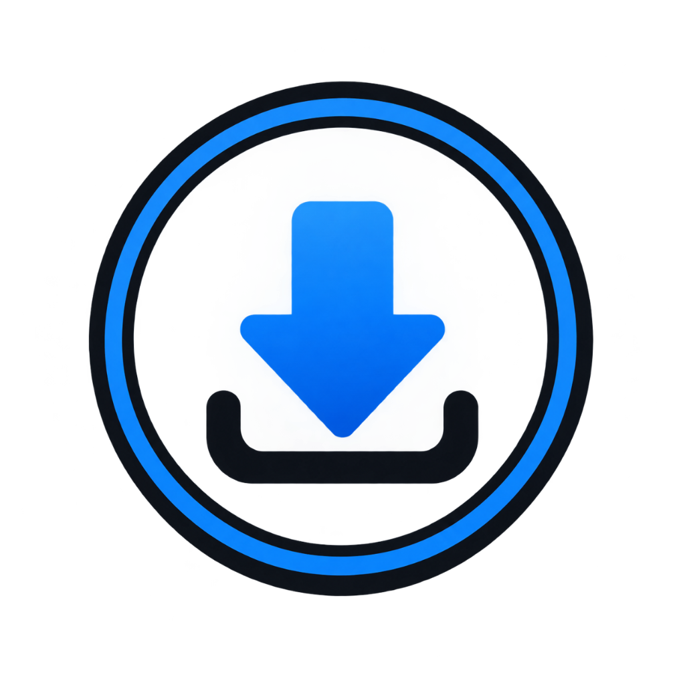

  

<h1 align="center">VNEDownloader</h1>

  <b>The high-speed, ad-free YouTube video and MP3 audio downloader for Android.</b> 
  Save videos in crisp HD MP4 or extract audio tracks directly into high-bitrate MP3 with zero subscriptions, zero ads, and 100% on-device privacy.

  

  <a href="https://github.com/kevinvanmerligt/VNEDownloader/releases/latest/download/VNEDownloader.apk"><b>👉 Click here to directly download VNEDownloader.apk 👈</b></a>

---

## 🌟 What is VNEDownloader?

**VNEDownloader** is a streamlined, lightweight Android application built to give you total control over media playback. Whether you're traveling offline, commuting, archiving educational material, or building an offline music library, VNEDownloader downloads content directly to your phone's local storage quickly and effortlessly.

No account registration, no third-party servers, and no tracking—just paste a link and enjoy your media offline anytime, anywhere.

---

## 🎯 What Can You Use It For?

### 🎵 1. Extract High-Quality MP3 Audio
- Convert any song, podcast, study lecture, speech, or DJ mix into a standalone **MP3 audio** file.
- Automatically selects the highest available audio bitrate for crisp sound fidelity.
- Listen offline in the background without needing to keep your screen awake or pay for background playback.

### 🎬 2. Download Full HD MP4 Videos & Shorts
- Fully compatible with standard YouTube video links, short URLs (`youtu.be`), and YouTube Shorts (`/shorts/`).
- Choose from multiple video resolutions: **360p, 480p, 720p HD, and 1080p Full HD**.
- Instant file size estimations help you manage storage before downloading.

### ⚡ 3. Ultra-Smooth 120Hz & 144Hz High Refresh Rate
- Built with native Android display mode unlocking.
- Automatically synchronizes with your device's maximum screen refresh rate (**60Hz, 90Hz, 120Hz, or 144Hz**) for butter-smooth scrolling and fluid animations on high-end gaming and flagship devices.

### 🔒 4. 100% Private, Ad-Free & On-Device
- **Zero Ads**: No intrusive popups, banners, or video ads interrupting your experience.
- **Direct Streaming**: Media downloads stream directly from source servers into your local storage without passing through any external proxy or third-party servers.
- **No Sign-In Required**: No credentials or personal accounts needed.

### 📲 5. Reliable Background Downloading
- Continue downloading even when you switch to other apps or turn off your screen.
- Integrated Android status bar notification shows real-time progress percentages and download status.

### 📶 6. Mobile Data Guard (Wi-Fi Only Mode)
- Prevent accidental cellular data consumption with the built-in "Download over Wi-Fi only" switch.

### 📁 7. Built-in Local History & One-Tap Playback
- All completed downloads are indexed in your local on-device history library.
- Tap any completed video or audio file to immediately open and play it in your preferred media player (VLC, MX Player, Google Files, or the default gallery).
- Manage storage directly within the app, with the option to delete history records alongside physical files.

---

## 📲 How to Install & Use

1. **Download the APK**  
   Tap the download badge above or click [Direct Download VNEDownloader.apk](https://github.com/kevinvanmerligt/VNEDownloader/releases/latest/download/VNEDownloader.apk).

2. **Install on Your Phone**  
   Open the downloaded `.apk` file from your notification panel or File Manager. If prompted by Android, grant permission to *"Install apps from this source"*.

3. **Paste & Enjoy**  
   Copy any YouTube or Shorts link, open VNEDownloader, tap **Paste**, select either **MP3 Audio** or your preferred **MP4 Video** quality, and hit Download!

---

## 📱 Device Requirements

- **Operating System**: Android 8.0 (Oreo) or higher (API level 26+)
- **Architecture**: Supports ARM64, ARMv7, and x86_64 devices
- **Storage**: Standard read/write permission to save files to your `Movies/VNEDownloader` directory

---

## ⚖️ Disclaimer

VNEDownloader is developed strictly for personal use and offline archiving of public domain, royalty-free, or user-owned content. Please respect copyright laws and the terms of service of content platforms. The developers do not host, store, or distribute any copyrighted media.
